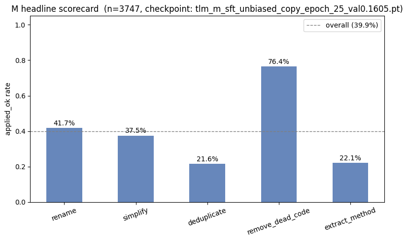
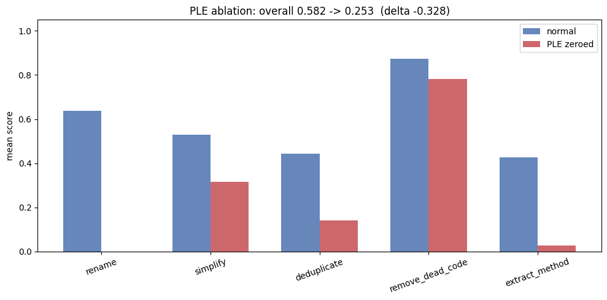

# TLM: a tiny language model that refactors Python

A small encoder-decoder transformer, **built and trained from scratch (no
pretrained weights, under 10M parameters)**, that rewrites Python code. Give it
a function and a task, and it returns the edit as a SEARCH/REPLACE block that
can be applied to the source automatically.

| Task | What it does |
|------|--------------|
| `rename` | Renames an identifier consistently across every use site |
| `simplify` | Rewrites verbose logic into a simpler equivalent |
| `deduplicate` | Pulls repeated code into a shared helper |
| `remove_dead_code` | Deletes unreachable and unused code |
| `extract_method` | Moves a block into its own function |

Everything in this repository was written for this project: the model
architecture, tokenizer, training pipeline, data generation, evaluation
scorers, and a CodeT5 baseline for comparison.

**Weights:** Hugging Face (link to be added)

## Why it is interesting

- **A model small enough to understand.** Three sizes (3.1M, 6.1M and 9.9M
  parameters) trained under identical conditions, so the effect of scale on
  each task can be measured directly.
- **Edits, not rewrites.** The model emits a SEARCH/REPLACE patch, so output is
  small, checkable and applicable to real files. A copy-pointer head lets it
  reuse input tokens instead of regenerating them.
- **Evaluation that does not trust the model.** Every output is applied to the
  source and scored per task. Scorers were audited, and an execution-based
  smoke test catches edits that look right but break the code.
- **Honest baselines.** Compared against CodeT5-small, both with its official
  pretrained weights and re-trained from scratch on the same data, to separate
  the effect of architecture from the effect of pretraining scale.

## Architecture

- Encoder-decoder (T5-style), Pre-Norm, rotary position embeddings on
  self-attention, tied input/output embeddings
- **Copy-pointer head:** a learned gate `p_gen` blends copying from the input
  with generating from the vocabulary, which fits an edit task where most
  output tokens already exist in the input
- **Per-layer task embeddings** on the encoder side, so one model serves all
  five tasks
- 10k BPE vocabulary with explicit indent, dedent and newline tokens
- Three-stage training: span-corruption pretraining on a 5-tier curriculum,
  a bridging stage into SEARCH/REPLACE format, then supervised fine-tuning

| Model | d_model | Layers (enc+dec) | Parameters |
|-------|---------|------------------|-----------|
| TLM-XS | 128 | 3+3 | 3.13M |
| TLM-S | 192 | 4+4 | 6.07M |
| TLM-M | 256 | 4+4 | 9.93M |

## Results

Held-out set, 750 examples per task. A result counts as correct
("applied_ok") when the edit applies cleanly and passes the task-specific
check. All models are supervised fine-tuning only.

| Model | rename | simplify | dedup | remove_dead_code | extract_method | **overall** |
|-------|--------|----------|-------|------------------|----------------|-------------|
| TLM-XS (3.1M) | 25.3% | 30.5% | 14.1% | 75.2% | 16.4% | **32.3%** |
| TLM-S (6.1M) | 43.1% | 35.9% | 18.6% | 77.7% | 17.5% | **38.6%** |
| TLM-M (9.9M) | 41.7% | 37.5% | 21.6% | 76.4% | 22.1% | **39.9%** |
| CodeT5-small, official weights (60M) | 60.8% | 48.4% | 41.1% | 88.9% | 38.7% | **55.6%** |



**What the numbers show**

- Going from 3M to 6M parameters helps a lot on `rename`, a task that needs
  many consistent edits in one pass. Going from 6M to 10M gives much smaller
  gains.
- `remove_dead_code` is nearly flat across sizes. It is a pure deletion task,
  so extra capacity does not help.
- A 60M model with large-scale pretraining is clearly stronger. These models
  show what a sub-10M model trained on a small task-specific corpus can do, and
  they do not claim to beat larger systems.
- Zeroing the task embeddings removes a large share of the score, so the task
  conditioning is doing real work:



## Repository layout

```
src/
  model_components/   encoder, decoder, attention, RoPE, copy-pointer head
  model_variants/     the TLM model, parameterised by ModelConfig
  data_set/           corpus extraction and corruption (span denoising,
                      bridging, before/after -> SEARCH/REPLACE)
  data_loaders/       datasets for each training stage
  training/           losses and loops (pretrain, SFT, RL, calibration)
  inference/          greedy decoding with KV cache
  eval/               per-task scorers and execution-based smoke tests
  codet5/             CodeT5 baseline pipeline
  tokenizer/          trained BPE vocabulary
notebooks/training/   pretraining, bridging, SFT and baseline notebooks
notebooks/eval/       scoring, qualitative samples, explainability
```

## Setup

```
pip install -e .
pip install -e ".[codet5]"   # only for the CodeT5 baseline notebooks
```

Training notebooks were run on Colab and Kaggle GPUs. The training corpora are
not included in this repository.

## Stack

Python, PyTorch, Hugging Face `tokenizers` and `transformers`, Weights & Biases.

## License

MIT
